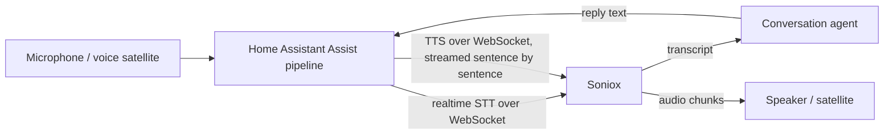

<p align="center">
  <picture>
    <source media="(prefers-color-scheme: dark)" srcset="custom_components/soniox/brand/dark_logo.png">
    
  </picture>
</p>

# Soniox for Home Assistant

[](https://hacs.xyz)
[](https://github.com/TomGrozev/ha-soniox/actions/workflows/validate.yml)
[](https://github.com/TomGrozev/ha-soniox/releases)
[](https://github.com/TomGrozev/ha-soniox/blob/main/LICENSE)

A custom Home Assistant integration maintained by **Tom Grozev** that exposes
[Soniox](https://soniox.com) as both a **speech-to-text** and a
**text-to-speech** provider for the Assist voice pipeline.

> **Disclaimer**: This is an unofficial project and is not affiliated with,
> endorsed by, or maintained by Soniox. The Soniox name and logo are used
> with permission for the purpose of this community integration.

## About this fork

This fork continues [Francesco Masaia's original ha-soniox](https://github.com/FrancescoMasaia/ha-soniox)
and carries significant changes on top of it. Compared with the original, this
fork:

- Ends an Assist turn as soon as Soniox endpoint detection fires, so the
  pipeline stops listening right after you finish speaking instead of waiting
  for Home Assistant's silence detection. Two options tune the detector.
- Optionally sends entity names, aliases, area and floor names to Soniox as
  context terms, so phrases such as "turn on the kitchen lights" recognise
  your devices. Off by default because it sends home data to Soniox.
- Offers a diagnostics download from the config entry for bug reports, with
  the API key redacted.
- Streams TTS sentence by sentence, so audio starts while the reply is still
  being generated and short openers followed by a tool call no longer stay
  silent.
- Keeps a warm-up TTS connection for the Assist pipeline only when the
  pipeline actually pairs the Soniox STT entity with the Soniox TTS entity.
- Adds a reauthentication flow when Soniox rejects the stored API key.
- Retries setup automatically when Soniox is unreachable at startup.
- Defaults new installs to Soniox STT v6 (`stt-rt-v6`, `stt-async-v6`).
- Declares the preferred sample rate, channel and bitrate options, so voice
  satellites such as Voice PE receive audio without Home Assistant's ffmpeg
  conversion step.

See [CHANGELOG.md](CHANGELOG.md) for the full history.

## How it works



- **STT (realtime)**: `stt-rt-v6` over WebSocket. Supports 60+ languages and
  sends low-latency final tokens as the user speaks.
- **STT (async)**: `stt-async-v6` via the Files + Transcriptions REST API.
  Buffers the utterance, uploads it, and polls for a higher-accuracy
  transcript.
- **TTS** (`tts-rt-v2` voices). Assist and `tts.speak` both use the Soniox
  WebSocket, so audio chunks (WAV/PCM) start playing before the sentence is
  finished. When the reply pauses (for example while the assistant runs a
  tool), the stream ends at the sentence boundary and the next text continues
  on a new one, so slow replies are not cut off and the audio plays as one
  response.

## Installation

### Via HACS (recommended)

1. Open **HACS → Integrations** in Home Assistant.
2. Click the **⋮** menu → **Custom repositories**.
3. Add `https://github.com/TomGrozev/ha-soniox` with category **Integration**.
4. Search for **Soniox**, install, then restart Home Assistant.
5. **Settings → Devices & Services → Add Integration → Soniox**.
6. Paste an API key from [console.soniox.com](https://console.soniox.com)
   and choose the **regional endpoint** that matches the project (US, EU, or Japan).

### Manual

Copy `custom_components/soniox/` into your Home Assistant `config/custom_components/`
directory, restart, and follow steps 5–6 above.

## Configuration

The API key and regional endpoint are set when you add the integration
(and can be changed later via **Reconfigure**). The key must belong to a
project in that region: an EU key will not authenticate against the US API,
and vice versa.

| Region           | REST / WebSocket domains                                              |
| ---------------- | --------------------------------------------------------------------- |
| United States    | `api.soniox.com`, `stt-rt.soniox.com`, `tts-rt.soniox.com`            |
| European Union   | `api.eu.soniox.com`, `stt-rt.eu.soniox.com`, `tts-rt.eu.soniox.com`   |
| Japan            | `api.jp.soniox.com`, `stt-rt.jp.soniox.com`, `tts-rt.jp.soniox.com`   |

Open the integration's **Configure** screen to set model, STT and voice
defaults:

| Option | Default | Notes |
| --- | --- | --- |
| Realtime STT model | `stt-rt-v6` | WebSocket streaming. Used by the `Speech-to-Text` entity. |
| Async STT model | `stt-async-v6` | File upload + poll. Used by the `Speech-to-Text (Async)` entity. |
| Extra STT language hints | *(none)* | Languages Soniox should also expect. Added after the pipeline language, so the pipeline language keeps priority. |
| Identify the spoken language | off | Lets Soniox detect the spoken language. |
| STT endpoint max delay (ms) | `2000` | 500–3000 ms. How long endpoint detection waits after the last audio chunk before it ends the turn. |
| STT endpoint latency adjustment level | `0` | 0–3. A higher level ends the turn sooner. |
| Send home names to Soniox | off | Sends exposed entity names, aliases, area and floor names as context terms. Because it sends home data to Soniox, it stays off until you enable it. |
| TTS model | `tts-rt-v2` | Soniox real-time TTS model. |
| Default TTS voice | `Maya` | Any voice from the Soniox catalog (see below). |
| Default TTS language | `en` | Two-letter ISO code. |
| TTS audio format | `mp3` | `mp3`, `wav`, or `pcm_s16le`. |
| TTS sample rate | `24000` | Used only for raw/wav formats. |
| Default speaking speed | `1.0` | Shown only for models that support speed adjustment. |

Per-service-call overrides:

- `voice`: any voice name (Maya, Adrian, Kenji, Sofia, …).
- `preferred_format`: `mp3`, `wav`, or `pcm_s16le` (Assist pipelines request their output format through this option).

## Use it in the Assist pipeline

**Settings → Voice assistants → Assistant → Add assistant**, then pick the
`Soniox Speech-to-Text` (or `Speech-to-Text (Async)`) entity and the
`Soniox` TTS entity. Use realtime STT for Assist; async STT is slower but
typically more accurate on a complete recording.

> **Note**: To use the browser mic icon on your laptop, Home Assistant must be
> served over HTTPS (browsers block microphone access on plain HTTP from
> non-localhost origins). The Home Assistant mobile apps don't have this
> restriction.

## Supported voices

`Maya`, `Daniel`, `Noah`, `Nina`, `Emma`, `Jack`, `Adrian`, `Claire`,
`Grace`, `Owen`, `Mina`, `Kenji`, `Rafael`, `Mateo`, `Lucia`, `Sofia`,
`Oliver`, `Arthur`, `Isla`, `Victoria`, `Cooper`, `Mason`, `Ruby`,
`Elise`, `Arjun`, `Rohan`, `Priya`, `Meera`. All voices speak all
supported languages.

## Diagnostics

Open the integration entry and choose **Download diagnostics**. The file
contains the configured options, the region, and the model and voice counts
of the TTS catalog. The API key is redacted. Attach it to bug reports.

## Troubleshooting

Enable debug logging to see per-session detail:

```yaml
logger:
  logs:
    custom_components.soniox: debug
```

With debug logging on, a realtime STT session logs the time from the last
audio chunk to the transcript as
`Soniox STT transcript … ms after the last audio chunk (endpoint detected)`
when Soniox's endpoint detection ended the turn, or
`(audio stream ended)` when Home Assistant closed the stream first. A
streaming TTS reply that ends early at a sentence boundary logs
`text paused at a sentence end; text_end on stream …`, and the
`first audio frame … after first text` line shows how long the first audio
took to arrive. If Soniox is unreachable at startup, setup asks Home
Assistant to retry automatically; if Soniox rejects the stored API key (401),
the integration starts a reauthentication flow so you can enter a new key
without removing and re-adding the entry.

## Issues

Please file bugs and feature requests at
[github.com/TomGrozev/ha-soniox/issues](https://github.com/TomGrozev/ha-soniox/issues).

## License

MIT (see [LICENSE](LICENSE)).
